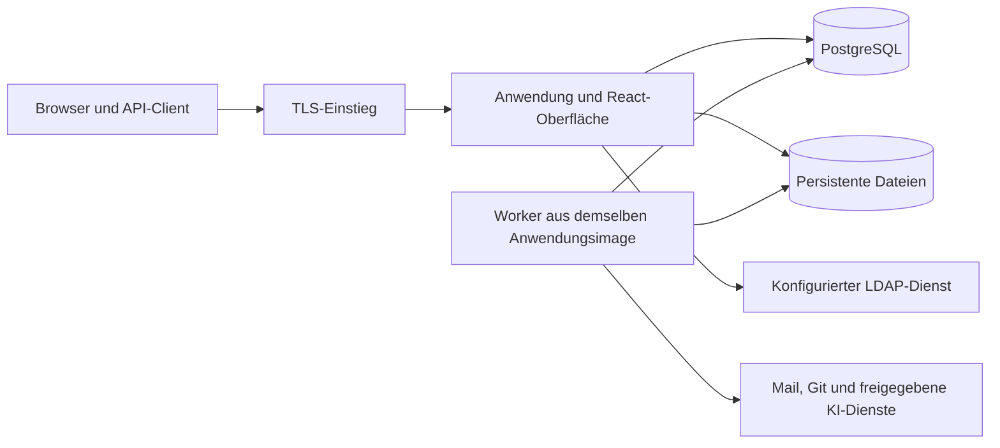

# Vorschlag für die Systemarchitektur

Stand 16. Oktober 2026 · TASK-003 · Entscheidungsgrundlage, keine freigegebene Umsetzung

Holger hat Java mit Spring Boot als Backend bestätigt (DEC-039). Docker, PostgreSQL, React und eine eigenständige Codebasis sind ebenfalls gesetzt. Modularer Monolith, React mit TypeScript, konkrete Versionen und die übrigen Architekturdetails bleiben Vorschläge zu OPEN-001 und OPEN-002. Es wurden weder Gerüstcode noch Datenbank, Container oder Technologietests erstellt.

Grundlage sind REQ-ARCH-001, REQ-ARCH-002, REQ-ORG-002, REQ-DATA-001, REQ-DATA-002 und REQ-API-001 aus [REQUIREMENTS.md](../REQUIREMENTS.md). Der Entwurf berücksichtigt außerdem den bestätigten Funktionsumfang und DEC-027 bis DEC-029 zur Organisationssicht, Feldverbotsregel und späteren 2FA-Erweiterung. Der [Rechteentwurf](PERMISSIONS.md) beschreibt die gemeinsame Zugriffsschnittstelle und fachliche Prüfszenarien. Abgesehen von der bestätigten Backendwahl nach DEC-039 bleiben die nachfolgenden technischen Details prüfpflichtige Vorschläge.

## Begründung der bestätigten Backendwahl

Beide Sprachen können dieses Produkt tragen. Für die erwarteten 15 gleichzeitig aktiven Nutzer ist die Sprache allein kein belastbarer Leistungsnachweis. Datenmodell, Abfragen, Rechteprüfung und Hintergrundarbeit müssen gemessen werden. „Von KI leichter zu schreiben“ ist kein ausreichendes Auswahlkriterium.

| Gesichtspunkt | Go | Java mit Spring Boot | Bewertung für dieses Projekt |
|---|---|---|---|
| Fachlich komplexe Abläufe | Klare, explizite Dienste; Integration der ausgewählten Bibliotheken bleibt Projektarbeit | Breites Framework für Web, Transaktionen und Sicherheit; verlangt feste Konventionen | Viele miteinander verbundene Fachregeln sprechen für einen einheitlichen Framework-Rahmen |
| LDAP und weitere Anmeldung | LDAP ist über Bibliotheken möglich; Anbieterabstraktion selbst gestalten | Spring Security bietet LDAP-Anbindung und eine bestehende Sicherheitsstruktur | Vorteil Java bei Integrationsaufwand, ohne dass dies das Rechtekonzept ersetzt |
| Containerbetrieb | Kompilierte Anwendung mit überschaubarem Laufzeitaufbau; tatsächliche Abhängigkeiten prüfen | JVM-Laufzeit und deren Speicherverhalten berücksichtigen | Go ist beim Betriebsaufbau attraktiv; es gibt aber keine feste RAM-Obergrenze |
| Moduldisziplin | Pakete und eigene Regeln für Abhängigkeiten | Spring Modulith kann Modulgrenzen automatisiert überprüfen | Vorteil Java für nachvollziehbare Grenzen zwischen KI-Beiträgen |
| Review und Wartung | Weniger Framework-Magie, dafür mehr selbst definierte Verkabelung | Mehr Framework-Wissen nötig; zu viele Annotationen und Abstraktionen können Reviews erschweren | Explizite Fachlogik und kleine Änderungen sind in beiden Varianten erforderlich |
| Datenbankwechsel | Treiber abstrahieren Verbindungszugriff, nicht sämtliche SQL-Unterschiede | Auch ein ORM macht SQL und Migrationen nicht automatisch portabel | Kein entscheidender Sprachvorteil; Adapter und spätere Tests sind nötig |
| Kosten und Geschwindigkeit | Mögliche Einsparungen im Betrieb sind zu messen | Mögliche Einsparungen bei Integrationsarbeit sind zu validieren | Entwicklungs-, Review- und Supportaufwand wiegt zunächst schwerer als ein ungeprüfter RAM-Vorteil |

**Entscheidung vom 16. Oktober 2026:** Java/Spring Boot ist gewählt (DEC-039); der Vergleich oben dokumentiert die Grundlage. Für die technische Prüfung sind zunächst gegenseitige KI-Reviews bestätigt, während zusätzliche menschliche Prüfung offenbleibt (DEC-040). Die frühere Empfehlung einer menschlichen Prüfung ist keine Voraussetzung dieser Backendentscheidung. Holgers fachliche Abnahme bleibt getrennt. Keines der Kriterien beweist eine Leistungsüberlegenheit ohne Erprobung.

Die technischen Grundlagen sind dokumentiert in [Spring Security LDAP](https://docs.spring.io/spring-security/reference/servlet/authentication/passwords/ldap.html), [Spring Modulith Verification](https://docs.spring.io/spring-modulith/reference/verification.html), [Go database/sql](https://go.dev/doc/database/) und der [Go-LDAP-Bibliothek](https://github.com/go-ldap/ldap). Sprach-, Framework- und Bibliotheksversionen werden erst bei Freigabe anhand unterstützter Versionen und Lizenzen festgelegt. Hier wird keine aktuelle Versionskombination zugesagt.

## Ein Produkt, intern klar getrennte Module

Der modulare Monolith hält Installation, lokale Transaktionen und Fehlersuche überschaubar. Jedes Fachmodul besitzt seine Daten und öffentliche Schnittstelle. Andere Module greifen über diese Schnittstelle zu, nicht direkt auf fremde Tabellen oder interne Klassen. Gemeinsam genutzt werden nur kleine technische Verträge: Kennungen, Zugriffskontext, Zeitquelle und Ereignishülle. Ein universelles Datenmodell für alle Fachobjekte wird nicht empfohlen.

| Modul | Eigene Daten / Verantwortung | Erlaubte Verbindung |
|---|---|---|
| Identität | Benutzer, externe Identitäten, Anmeldedaten, Sitzungen | Liefert geprüfte Identität; lokale und LDAP-Anbieter als Adapter |
| Berechtigungen | Gruppen, Mitgliedschaften, Rechtezuweisungen und Rechteversionen | Bewertet vom Fachmodul übergebene Ressourcenmerkmale; lädt keine Fachobjekte selbst |
| Unternehmen und Projekte | Unternehmenskontext, Kundenorganisationen, Projekte, Konfiguration und Vorlagen | Referenziert stabile Benutzerkennungen; liefert gültige Projektregeln |
| Tickets | Typisierte Felder, Status, Übergänge, Kommentare und Historie | Nutzt Identität, Rechte, Projekte und Dateischnittstelle |
| Zeit | Buchungen, Korrekturen und Auswertungsregeln | Prüft Referenzen über Projekt- und Ticketschnittstelle |
| Wissen | Dokumente, optionale Sprachfassungen, Revisionen und Freigaben | Nutzt Projekte, Rechte und Dateien; kennt keine Editorbibliothek im Fachmodell |
| Anforderungen | Kriterien, Freigabestatus und Revisionen | Verknüpft Tickets, Wissen und Git über stabile Referenzen |
| Helpdesk | Postfächer, Nachrichtenbezüge, Servicekalender, SLA-Zustände, Eskalationen | Orchestriert Ticketaktionen und ausgehende Nachrichten |
| Git-Integration | Anbieterzugänge, Repository-Zuordnungen und erlaubte Metadaten | Anbieteradapter für GitHub/GitLab; V1 nur Zuordnung und Anzeige |
| Verknüpfungen | Typisierte Beziehungen zwischen Ressourcen | Fragt registrierte Ressourcen-Schnittstellen nach Existenz und erlaubter Anzeige |
| KI-Unterstützung | Skill-Versionen, Modellzuordnungen, Vorschläge und Bestätigungsnachweise | Nutzt berechtigte Leseschnittstellen; führt bestätigte Aktionen über Fachmodule aus |
| Technische Dienste | Dateispeicher, Aufträge, Outbox, Vorlagen, Audit und Diagnose | Definierte Ports; Infrastrukturadapter hängen von Fachverträgen ab |

Das Portal und die interne Oberfläche sind zwei Ansichten derselben Fachlogik. Ein zweites Portal-Backend mit abweichender Rechteprüfung wird nicht empfohlen. Spätere Module wie Ressourcenplanung, Budgets oder Testmanagement erhalten eigene Grenzen; ihre vorgeschlagenen Funktionen stehen im [Funktionsinventar](FUNCTION_INVENTORY.md).

Abhängigkeiten werden gerichtet und zyklenfrei geplant: Zeit kennt Tickets, Tickets kennen keine Zeitbuchungsimplementierung. Eine Ticketansicht mit Zeitsumme verwendet einen separaten Abfragedienst. Verknüpfungen rufen bereitgestellte Leseschnittstellen auf; sie umgehen keine Zugriffsprüfung. Die Zusammensetzung geschieht an einem klaren Anwendungseinstieg. Spring Modulith kann bei Java insbesondere Zyklen, unerlaubte interne Zugriffe und erlaubte Abhängigkeiten prüfen; es beweist weder korrekte Fachregeln noch sichere Rechte.

Für parallele KI-Arbeit werden später kleine Aufgaben je Modul und Vertrag vergeben. Änderungen an gemeinsamem Zugriffskontext, API oder Ereignissen werden vor abhängigen Aufgaben koordiniert. Versionsverwaltung, Claim-PRs und getrennte Worktrees bleiben gemäß [AI_WORKFLOW.md](AI_WORKFLOW.md) verbindlich. Eine KI darf kein neues Framework oder eine konkurrierende Aufgabenliste nebenbei einführen.

## Daten und Vorbereitung späterer Mandanten

Ein Unternehmen ist die zukünftige Mandantengrenze; seine Kundenorganisationen bilden eine darunterliegende fachliche Zuordnung. V1 erzeugt genau einen Unternehmenskontext. Er wird serverseitig an alle Abfragen, Dateien, Caches, Aufträge, Vorlagen, Suchvorgänge und KI-Aufrufe weitergegeben. Ein Parameter aus dem Browser kann ihn nicht eigenmächtig wechseln.

Vorschlag: Unternehmenskennung an fachlichen Datensätzen und Referenzen, einschließlich zusammengesetzter Eindeutigkeits- und Fremdschlüsselregeln, wo sie unternehmensübergreifende Verknüpfungen verhindern. Speicherpfade sind ebenfalls zugeordnet, aber der Pfad allein erteilt keine Berechtigung. Für spätere Mandanten bleiben eigene Datenbanken, Schemas oder gemeinsame Tabellen offen; ein universelles Mehrmandantenprodukt wird V1 dadurch noch nicht.

PostgreSQL ist die einzige unterstützte Datenbank. Repositories, Transaktionen, Migrationen, Volltextsuche und Auftragsabholung erhalten klar begrenzte Datenbankadapter. Fachmodule erhalten keine SQL-Dialektauswahl. Gezielte PostgreSQL-Funktionen sind möglich, wenn ihr Einsatz und ein späterer Ersatzpfad dokumentiert sind. Ein Verzicht auf jede Datenbankspezialität würde Portabilität nicht automatisch herstellen und kann unnötig Aufwand erzeugen.

MariaDB, SQL Server und Oracle erhalten jetzt weder Treiber noch Migrationen oder CI-Umgebungen. Eine tatsächliche Unterstützung braucht später Prüfungen von Datentypen, Sortierungen, Zeitzonen, Transaktionsisolation, Sperren, Pagination, Migrationen und Sicherung. Auch ein ORM beseitigt diese Unterschiede nicht. PostgreSQL Row-Level Security ist eine mögliche zusätzliche Absicherung; sie ersetzt keine portable Anwendungsprüfung. Tabellenbesitzer sowie bestimmte privilegierte Rollen können sie umgehen, wie die [PostgreSQL-Dokumentation](https://www.postgresql.org/docs/current/ddl-rowsecurity.html) erläutert. Ihre Verwendung bleibt offen.

Projektkonfigurationen erhalten stabile Feldkennungen, Typen, Validierungen und Versionen. Bezeichnungen können übersetzt werden. Eine Feldumbenennung verändert keinen API-Schlüssel. Häufig gefilterte Standardfelder bleiben strukturiert abfragbar. Ob kundendefinierte Werte typisierte Tabellen oder ein begrenztes Dokumentformat verwenden, entscheidet TASK-005 anhand von Filter-, Index- und Portabilitätsanforderungen. Eine beliebige JSON-Sammlung für das ganze Produkt wird nicht empfohlen.

## API-Grundvertrag als Vorschlag

Empfohlen wird eine HTTP/JSON-API unter `/api/v1`, beschrieben durch [OpenAPI](https://spec.openapis.org/oas/latest.html). Oberfläche und Integrationen verwenden dieselben fachlichen Operationen. Ein internes Datenbankfeld wird nicht allein dadurch öffentlich, dass es im Modell existiert. Folgende Regeln konkretisieren OPEN-013:

| Thema | Vorgeschlagener Vertrag |
|---|---|
| Anmeldung | Browser-Sitzung in geschütztem Cookie mit CSRF-Schutz; API-Zugänge separat widerrufbar und eingeschränkt. Ein Token erweitert nie die Rechte seiner Identität. Genaue Tokenform und Laufzeiten noch entscheiden. |
| Versionierung | Additive Änderungen innerhalb v1; inkompatible Verträge über neue Hauptversion mit dokumentierter Übergangsfrist. Diese Frist ist noch offen. |
| Fehler | Maschinenlesbarer Code und Korrelationskennung, lokalisierbare Meldung; Problem Details nach [RFC 9457](https://www.rfc-editor.org/rfc/rfc9457.html). Keine Stacktraces, Geheimnisse oder verborgenen Werte. |
| Listen | Begrenzte Seitengröße, Cursor und stabile Sortierung mit eindeutiger Zusatzkennung. Rechtefilter vor Zählung und Pagination; nur freigegebene Filterfelder. |
| Konflikte | Versionierte Ressourcen, ETag und If-Match bei Änderungen. Veralteter Stand ergibt 412; fachlich unzulässiger Zustand 409. HTTP-Bedingungen richten sich nach [RFC 9110](https://www.rfc-editor.org/rfc/rfc9110.html). |
| Wiederholte Schreibaufrufe | Schlüssel für wiederholbare Anlage- und Aktionsaufrufe, gebunden an Unternehmen, Identität, Operation und Eingabeinhalt. Derselbe Schlüssel mit anderem Inhalt wird abgewiesen. Speicherung und Fachänderung atomar; Aufbewahrungsfenster offen. Rechte erneut prüfen, auch vor Rückgabe eines alten Ergebnisses. |
| Lange Vorgänge | Auftragskennung und abrufbarer Zustand statt blockierender Anfrage. Auftrag und Ergebnis bleiben an Berechtigungen gebunden. |
| Beziehungen | Stabile Ressourcenkennungen; jede Zielanzeige prüft Rechte. Keine Offenlegung fremder Titel oder Kundennamen durch Verknüpfungen. |

Illustrative Abläufe sind „Ticket erstellen“, „erlaubten Statusübergang ausführen“, „Zeit buchen“ und „KI-Vorschlag bestätigen“. Es gibt keinen allgemeinen Endpunkt, der beliebige interne Eigenschaften ohne Fachvalidierung setzt. Für Wiki-Konflikte werden Unterschiede und erneutes Speichern angeboten; kollaborative Echtzeitbearbeitung ist nicht erforderlich. Ein vollständiges OpenAPI-Dokument folgt erst nach Freigabe der Fachverträge.

## Zuverlässige Hintergrundarbeit

E-Mail-Eingang, Benachrichtigungen, SLA-Berechnung, Git-Aktualisierung und KI-Aufrufe dürfen interaktive Arbeit nicht unbegrenzt blockieren. Vorschlag für V1: dauerhafte Aufträge und Outbox in PostgreSQL; kein zusätzlicher Message-Broker als Pflichtdienst. Fachänderung und zugehöriges Ereignis werden gemeinsam gespeichert. Ein Worker verarbeitet Aufträge mit begrenzten Wiederholungen, Zeitlimits, temporären Reservierungen und sichtbarem Fehlerzustand.

Wiederholte interne Verarbeitung darf keine doppelten Fachwirkungen erzeugen. Beim IMAP-Abruf wird die Herkunft mit Mailkonto, überwachtem Ordner, UIDVALIDITY und UID nachvollzogen; eine Message-ID allein genügt nicht als globaler Duplikatschlüssel. Die Gültigkeit der IMAP-Kennungen beschreibt [RFC 9051](https://www.rfc-editor.org/rfc/rfc9051.html#section-2.3.1.1). Ein Wechsel von UIDVALIDITY benötigt einen eigenen Abgleich, nicht das ungeprüfte Neuanlegen aller Nachrichten. Nachrichtenzuordnung und Ticketanlage benötigen eine konsistente Transaktion. Unbekannte Absender, Threads, CC und organisationsübergreifende Antworten sind offene Fachregeln in TASK-006, keine aus Headern ableitbare Zugriffsfreigabe.

SMTP kann nach einem Verbindungsabbruch einen unklaren Versandstatus hinterlassen; das Risiko doppelter Nachrichten durch Zeitüberschreitungen beschreibt [RFC 5321, Abschnitt 6.1](https://datatracker.ietf.org/doc/html/rfc5321#section-6.1). Dieser Zustand wird im Vorschlag gesondert angezeigt und nicht blind beliebig oft wiederholt. Die Forderung aus REQ-TKT-005 nach Vermeidung doppelter Benachrichtigungen muss in TASK-006 zwischen interner Auftragsduplizierung und tatsächlicher externer Zustellung präzisiert werden; dieser Entwurf verspricht keine garantierte Exactly-once-Zustellung.

Nachtrag vom 13. Oktober 2026: Die Präzisierung liegt nun im [Helpdesk- und SLA-Entwurf](HELPDESK_SLA.md) und im aktualisierten Abnahmevorschlag zu REQ-TKT-005 vor. Die fachliche Gesamtprüfung bleibt offen.

SLA-Fristen werden deterministisch aus versionierten Regeln und Servicekalendern berechnet. Jobs erhalten Unternehmenskontext, begrenzte Dienstrechte und eine überprüfbare Zeitquelle. Sommerzeit, Pausen, Wiedereröffnung und Prioritätswechsel benötigen vor Umsetzung Beispiele aus OPEN-008. KI entscheidet keine verbindlichen Fristen.

## Docker, Dateien und Betrieb

Ein versioniertes Anwendungsimage kann im Vorschlag als Webprozess oder Worker starten. PostgreSQL läuft als eigener Dienst. Für kleine Installationen können diese Dienste auf demselben Host betrieben werden. Der [Betriebsentwurf aus TASK-010](OPERATIONS.md) konkretisiert Plattform, TLS, Ressourcen und Persistenz als Vorschläge. Eine ausführbare Compose-Datei und Installation folgen erst nach Implementierungsfreigabe.

Dateien liegen auf einem persistenten Volume außerhalb des Containerlebenszyklus. Ein Storage-Port lässt später Objektspeicher zu. Metadaten, Inhalt, Uploadabschluss und Aufräumen verwaister Dateien benötigen ein beschriebenes Konsistenzverfahren. Dateien werden über eine berechtigte Anwendungsschnittstelle ausgeliefert. Uploadgrenzen, Prüfung schädlicher Inhalte und Umgang mit Rich Text sind vor Auswahl der Bibliotheken festzulegen.

Sicherungen umfassen Datenbank, Dateien, Konfiguration und erforderliches Schlüsselmaterial in einem konsistent wiederherstellbaren Stand. Wiederherstellung wird später in einer frischen Umgebung geprüft. DEC-038 bestätigt als Planungsziel höchstens eine Stunde Datenverlust und vier Stunden Wiederanlauf bei vollständigem Serverausfall; der [Betriebsentwurf](OPERATIONS.md) beschreibt den noch praktisch zu prüfenden Gesamtprozess. Ein älteres Docker-Image allein macht eine Schemaänderung nicht rückgängig. Updates brauchen Migrationsreihenfolge, Sperre konkurrierender Migrationen, Sicherung, Wartungsfenster und einen getesteten Wiederherstellungsweg.

Internetbedarf wird je Zweck dokumentiert. Er legitimiert weder unerklärte Telemetrie noch den Versand von Kundendaten. Vorgeschlagen wird, Kernarbeit bei externen Ausfällen weiter zu ermöglichen, während Mail, Git oder KI einen sichtbaren Rückstand melden; das verbindliche Verhalten bleibt unter OPEN-012 zu entscheiden. LDAP und Ollama dürfen gezielt interne Ziele verwenden. Zielprüfung, TLS, Proxy und Umgang mit Weiterleitungen müssen diese freigegebenen internen Dienste berücksichtigen.

## Frontend, Wiki, Markenauftritt und KI

React mit TypeScript wird für überprüfbare API-Typen und gemeinsame UI-Bausteine empfohlen. Übersetzungsschlüssel, Fachkennungen und angezeigte Texte bleiben getrennt. Deutsch und Englisch sind gleichwertige Prüffälle; zusätzliche Sprachen verwenden denselben Katalog. Datum, Zeitzone und Zahlenformat werden nicht aus der Sprache allein abgeleitet.

Der Wiki-Inhalt erhält ein versioniertes, dokumentiertes Format mit erlaubten Elementen, Referenzen und Bildern. Die konkrete Rich-Text-Bibliothek ist noch offen. Ein Wechsel der Editorbibliothek darf keine unlesbaren Bestandsdaten erzeugen. Sprachfassungen sind optional, teilen eine fachliche Dokumentkennung und haben getrennte Revisionen. Ein fehlender übersetzter Inhalt wird mit sichtbarer Ursprungssprache angezeigt, nicht automatisch als bestätigte Übersetzung ausgegeben.

Logo und Farben werden über definierte Designvariablen angewendet; Anwendung, Portal, Anmeldung und E-Mail-Vorlagen verwenden denselben Unternehmensauftritt. Vorschlag: kein frei ausführbares Kunden-JavaScript. Vorlagen erhalten nur berechtigte Daten. Spätere PDF-Ausgabe nutzt diese Inhalts- und Vorlagenverträge, benötigt aber einen eigenen Layouttest.

KI-Anbieter werden über einen Vertrag für Fähigkeiten, Modellzuordnung, Aufruf und Ergebnis angebunden. OpenAI, Anthropic/Claude und Ollama sind die bestätigten Anbieter; ihre konkreten Lieferzeitpunkte stehen noch unter OPEN-003. Nur Administratoren konfigurieren Endpunkte, Modelle und Markdown-Skills. Ein Modellzugang ist keine Fachberechtigung.

Der Ablauf lautet: berechtigten Kontext zusammenstellen, Skill-Version auswählen, Vorschlag erzeugen, Quellen und Änderungen anzeigen, ausdrückliche Bestätigung einholen, Rechte und Objektversion erneut prüfen, normale Fachaktion ausführen. Provider-Ausgaben werden strukturell validiert. Eingelesene Dokumente sind Daten, keine Freigabe zur Ausführung. Aus einem lokalen Modellfehler entsteht kein stiller Cloud-Fallback. Der [KI-Entwurf aus TASK-008](AI_USE_CASES.md) konkretisiert diese Verträge. Kosten-, Laufzeit- und Datenklassenregeln müssen vor der ersten KI-Auslieferung bestätigt werden; vier V1-Anwendungsfälle und der interne Nutzerkreis sind durch DEC-034 und DEC-035 entschieden.

## Messplan und Entscheidungspunkte

Als erster Referenzrechner wird **4 vCPU, 16 GB RAM und SSD** vorgeschlagen, ausschließlich als Ausgangspunkt späterer Messungen, ohne Betriebszusage und ohne neue RAM-Obergrenze. Lokale Modellhardware kommt gesondert hinzu. Das Profil umfasst 15 aktive Nutzer, 500–1.500 neue Tickets pro Monat und im Langzeittest 90.000 Tickets mit definierten Historien, Anhängen und Feldrechten.

Vorgeschlagene Messziele zur Diskussion: p95 höchstens 500 ms für Ticketlisten und Detail-API, höchstens 1 s für Suche und Speichern, jeweils unter diesem Lastprofil ohne externe Providerlaufzeit. Zusätzlich sind Ende-zu-Ende-Bedienzeit, Fehlerrate, Mailrückstand und SLA-Verzögerung zu messen. Diese Antwortzeitziele sind bisher weder bestätigt noch erreicht; die inzwischen bestätigten Wiederherstellungsziele aus DEC-038 werden separat betrachtet. Der Vergleich mit Redmine/Easy8 benötigt gleichwertige Daten, Funktionen, Hardware und bekannte Versionen.

Das 1-TB-Live-Budget wird vor allem durch Anhänge beeinflusst: Ein rein illustratives Profil mit 90.000 Tickets, zwei Dateien je Ticket und je 5 MB ergibt bereits rund 900 GB Dateiinhalte, ohne Datenbank, Revisionen, Suchindex oder Reserve. Deshalb sind Größenlimits, Aufbewahrung und reales Kundenprofil Voraussetzung einer Dimensionierung. Sicherungen benötigen ein separates Budget.

| Entscheidung / Arbeit | Nächster prüfbarer Schritt |
|---|---|
| OPEN-001, OPEN-002 | Java/Spring Boot ist bestätigt; Versionen, React/TypeScript und modularen Monolithen entscheiden |
| OPEN-005, OPEN-006 | Rechteentwurf prüfen; Datenmodell und Sitzungs-/LDAP-Verhalten verbindlich machen |
| OPEN-013 | API-Regeln einschließlich Token, Wiederholungsfenster und Versionsübergängen abstimmen |
| TASK-005, TASK-006 | Zwei Projektabläufe, Feldmodell und berechenbare SLA-Beispiele spezifizieren |
| TASK-002, TASK-008 | Funktionsinventar vervollständigen; vier interne KI-Fälle sind für V1 bestätigt, Anbieterreihenfolge und Betriebsgrenzen noch offen |
| TASK-010, OPEN-014 | Vorliegenden Betriebsentwurf, Referenzdaten und vorgeschlagene Leistungsziele prüfen; RPO/RTO aus DEC-038 praktisch nachweisen |
| OPEN-017 | Gegenseitige KI-Reviews sind bestätigt; konkrete Sitzungen, Nachweise und Freigabeschwellen klären; menschliche Prüfung bleibt offen |

Das Ergebnis ist bereit zur Prüfung. Eine Annahme der Architektur ersetzt weder die noch offenen Detailentscheidungen noch einen gesonderten Implementierungsauftrag. Technische Quellen wurden am 13. Oktober 2026 gelesen; es wurden keine Last-, Integrations- oder Produktsicherheitstests ausgeführt.
