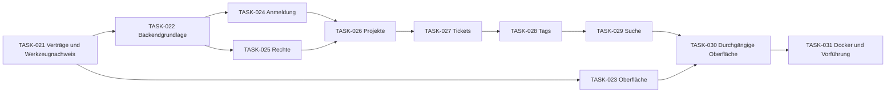

# Vorlage für den ersten Entwicklungsauftrag

Stand 17. Oktober 2026 · TASK-020 · Empfehlungen zur Entscheidung, keine Implementierungsfreigabe

Der nächste sinnvolle Schritt ist ein begrenzter, vorführbarer Ablauf: **anmelden → Projekt öffnen → Ticket bearbeiten → Tags vergeben → Ticket wiederfinden**. Dieser erste Entwicklungsstand soll die gemeinsame technische Grundlage und ihre Rechteprüfung erproben. Er ist noch keine verkaufbare V1. Aufgaben, Besitzer und Status stehen ausschließlich in [TODO.md](../TODO.md); dort sind TASK-021 bis TASK-031 als gesperrte Planung vorgemerkt.

Bestätigt sind Java/Spring Boot, React/TypeScript, ein modularer Monolith, HTTP/JSON im REST-Stil mit OpenAPI, PostgreSQL und Docker. Die folgenden Werkzeugversionen, Detailverträge und Liefergrenzen sind **Vorschläge**. Die bestehenden DEC-001 bis DEC-050 und [Anforderungen](../REQUIREMENTS.md) werden nicht ersetzt. Holger kann einen eng begrenzten Auftrag erteilen, ohne bereits alle späteren V1-Details abzunehmen.

## Drei fachliche Entscheidungen für den Einstieg

| Frage | Empfehlung | Auswirkung und weiterhin offene Details |
|---|---|---|
| Welcher erste Entwicklungsumfang? | Zunächst interne Benutzer mit lokaler Anmeldung, Projekte, Tickets, Tags und Suche. | LDAP und Kundenportal folgen innerhalb V1. Soll beides schon in der ersten Vorführung enthalten sein, müssen Aufgaben und Abhängigkeiten vor Beginn erweitert werden. |
| Welche feste Sitzungsdauer als Ausgangswert? | 8 Stunden ab erfolgreicher Anmeldung, administrativ einstellbar. | Nur die feste Dauer ist bestätigt, nicht dieser Wert. Grenzen, erlaubte Deaktivierung und Wirkung geänderter Einstellungen sind zusätzlich festzulegen. Keine Inaktivitätsfrist. |
| Wie entstehen lokale Konten? | Administrator lädt ein; Benutzer setzt sein Passwort über einen zeitlich begrenzten E-Mail-Link. | Einladungs-/Rücksetzfristen und erster Administrator bleiben festzulegen. Der echte Ablauf braucht SMTP; ein synthetisches Entwicklungskonto ersetzt ihn nicht. Keine offene Selbstregistrierung vorgeschlagen. |

Diese Fragen wurden Holger vorgelegt. **Zum Stand dieser Fassung liegt keine Antwort auf diese drei Auswahlfragen vor.** Erst eine ausdrückliche Antwort erhält eine neue DEC-ID. Bereits beantwortete Fragen zu fester Frist, externen Tag-Erstellern und V1-Suchbereichen werden nicht erneut geöffnet.

## Technische Empfehlungen als zusammenhängendes Paket

### P1 Werkzeugbasis und reproduzierbare Builds

| Bereich | Vorgeschlagene Linie | Begründung und Qualifikation vor Verwendung |
|---|---|---|
| Java | Eclipse Temurin 25 LTS | Eine langfristig gepflegte Java-Linie. Konkretes Update und Containerbasis in TASK-021 festhalten. [Temurin-Support](https://adoptium.net/support). |
| Backend | Spring Boot 4.1.x, Maven mit Wrapper | Die am 17.10.2026 gelesene Boot-Dokumentation nennt 4.1.1, Java 17 bis 26 und Maven ab 3.6.3. Java 25 liegt darin; die gesamte Kombination ist dennoch praktisch zu prüfen. Maven 3.9.x als Kandidat. [Systemanforderungen](https://docs.spring.io/spring-boot/system-requirements.html). |
| Datenbank | PostgreSQL 18.x | Unterstützte stabile Hauptversion, laut Hersteller bis November 2030 gepflegt. Gelesener Patchstand: 18.6. Keine Vorabversion einplanen. [Versionspolitik](https://www.postgresql.org/support/versioning/). |
| Oberfläche | React 19.3, TypeScript 6.0, Vite 8 | Ausgangskandidaten aus den offiziellen Veröffentlichungen; Compileroptionen einschließlich `strict` und Browserziel ausdrücklich setzen. Erst der gemeinsame Build qualifiziert die Kombination. [React-Versionen](https://react.dev/versions), [TypeScript 6.0](https://devblogs.microsoft.com/typescript/announcing-typescript-6-0/), [Vite 8](https://vite.dev/blog/announcing-vite8). |
| Frontend-Build | Node.js 24 LTS und npm | Ein Paketmanager und eine Lockdatei. Node wird für den Build benötigt; es ist kein zusätzlicher Anwendungsserver im Zielbetrieb vorgesehen. [Node-Versionen](https://nodejs.org/en/about/previous-releases). |

Keine dieser Versionen ist bereits installiert oder getestet. TASK-021 erfasst exakte Versionen, Herkunft, Lizenzinformationen, Wartungsstand und Buildnachweis; keine schwebenden `latest`-Angaben im ausgelieferten Build. Frameworkverwaltete Bibliotheken folgen möglichst dessen getesteter Versionsverwaltung. Eine notwendige Abweichung erhält eine begründete Entscheidung und erneute Prüfung. Die offene Produktlizenz unter OPEN-020 wird dadurch nicht ausgewählt.

### P2 Module, Daten und Transaktionen

Empfohlen sind **direkte Java-Aufrufe über öffentliche Modulschnittstellen innerhalb desselben Prozesses**. REST verbindet Browser beziehungsweise Integrationen mit der Anwendung. gRPC bietet für diese gemeinsame Anwendung zunächst keinen benötigten zusätzlichen Kommunikationsweg. Separate Worker verwenden dieselben Fachverträge; spätere Mail-/SLA-Aufträge benötigen dauerhafte Aufträge und Wiederholungsregeln, keine flüchtigen Ereignisse als alleinige Zustellgarantie.

Jedes Modul besitzt seine Tabellen und Repository-Adapter. Andere Module greifen über dessen Vertrag zu, nicht über fremde ORM-Entitäten oder SQL-Abfragen. Vorschlag: Spring Data JPA für gewöhnliche Fachobjekte; PostgreSQL-spezifische Suchabfragen in einem klar abgegrenzten JDBC-Adapter des Suchmoduls. Suchprojektionen werden aus freigegebenen Modulverträgen aufgebaut, nicht durch Zugriff auf fremde interne Tabellen. Datenbankunabhängige Fachverträge bereiten andere Datenbanken vor; sie versprechen noch keine lauffähigen Alternativen.

Für Schemaänderungen wird Flyway als einziger Migrationsweg empfohlen. Boot beschreibt Flyway einschließlich des PostgreSQL-Moduls; automatisches ORM-Schemaändern ist nicht der Produktionsweg. [Spring-Boot-Datenbankinitialisierung](https://docs.spring.io/spring-boot/how-to/data-initialization.html).

Fachänderung, Historie, Tag-Zuordnung und erforderliche Suchaktualisierung müssen bei zusammengesetzten Änderungen denselben bestätigten Stand abbilden. Die genaue JPA-/JDBC-Transaktionsbeteiligung, Flush-Reihenfolge und Rückabwicklung wird vor darauf aufbauenden Modulen praktisch geprüft. Die Rechte-/Versionsregeln aus [TECHNICAL_CONTRACTS.md](TECHNICAL_CONTRACTS.md) gelten auch beim gleichzeitigen Rechteentzug. Modulzyklen und verbotene Datenzugriffe sollen automatisch auffallen. Spring Modulith ist dafür ein Kandidat; die gelesene [Kompatibilitätsübersicht](https://docs.spring.io/spring-modulith/reference/appendix.html) belegt die vorgeschlagene Boot-4.1-Kombination nicht eindeutig. TASK-021 muss diese Lücke schließen oder einen begründeten alternativen Prüfweg festhalten.

### P3 Anmeldung und Rechte vor Fachfunktionen

Empfehlung: Spring Security und serverseitige, in PostgreSQL gespeicherte Sitzungen; Spring Session JDBC ist ein Integrationskandidat. [JDBC-Sitzungsspeicher](https://docs.spring.io/spring-session/reference/configuration/jdbc.html). Die unveränderliche erfolgreiche Anmeldezeit und das daraus berechnete absolute Ablaufdatum sind fachlich maßgeblich. Eine Framework-Einstellung für Inaktivität ersetzt diese Regel nicht und darf keine zusätzliche frühere Abmeldung auslösen. Sitzungsrotation und Serverneustart verlängern die Frist nicht. Passwortprüfung verwendet einen Framework-Encoder; Algorithmus und Kostenparameter werden qualifiziert, keine eigene Kryptografie.

Browser und API sollen unter derselben Herkunft erreichbar sein. Empfohlen sind geschützte Sitzungscookies, CSRF-Schutz für verändernde Browseraufrufe und keine Sitzungstokens im Browser-Lokalspeicher. SPA und CSRF müssen ausdrücklich zusammen konfiguriert und geprüft werden. [Spring Security für CSRF](https://docs.spring.io/spring-security/reference/servlet/exploits/csrf.html). Spätere Integrationszugänge besitzen einen eigenen Vertrag; sie werden nicht aus einem Browsercookie abgeleitet.

Die aktuelle Konto-/Gruppen-/Projekt-/Feldberechtigung wird bei geschützten Operationen serverseitig durchgesetzt. Feldverbote gewinnen gemäß DEC-028. Für allgemeine Aktionsrechte und administrative Sonderrechte ist vor TASK-025 der konkrete Algorithmus aus [PERMISSIONS.md](PERMISSIONS.md) zu entscheiden. Eine akzeptierte Hintergrundaufgabe benötigt später keinen weiterhin geöffneten Browser, bleibt aber an ihren aktuellen Ausführungskontext gebunden.

### P4 API und UI als gemeinsamer Vertrag

Empfohlen wird OpenAPI 3.1.1 als konkrete Vertragsfassung; sie ist eine Auswahl, keine Behauptung über die neueste Spezifikation. [OpenAPI 3.1.1](https://spec.openapis.org/oas/v3.1.1.html). TASK-021 qualifiziert einen Generator für den TypeScript-Client an Erfolgs-, Fehler- und Konfliktantworten. Transporttypen dürfen nicht unabhängig in Java und TypeScript auseinanderlaufen; ORM-Entitäten werden nicht direkt ausgegeben.

Die Vorschläge aus [TECHNICAL_CONTRACTS.md](TECHNICAL_CONTRACTS.md) zu `/api/v1`, Fehlerkörpern, Versionserwartung, Seitennavigation und Wiederholbarkeit werden für den ersten Umfang ausdrücklich ausgewählt und vor Implementierung festgeschrieben. Der vorhandene Vertrag unterscheidet unter anderem veraltete Versionsbedingungen, fehlende Bedingungen und fachliche Konflikte; neue Module erfinden keine abweichenden Antworten. API-Zugang umgeht keine UI-Rechte.

Die Oberfläche startet mit Deutsch/Englisch, Übersetzungsschlüsseln, zentralen Farbvariablen und einem Platz für das Unternehmenslogo. Lade-, Leer-, Fehler-, Rechte- und Konfliktzustände gehören zum ersten Ablauf. Die vollständige Branding-Verwaltung für Portal, Anmeldung und E-Mails bleibt V1-Arbeit; ein vorbereitetes Farbsystem erledigt sie noch nicht.

## Erster vorführbarer Ablauf und seine Grenzen

Vorschlag für synthetische Beispieldaten: zwei Projekte mit unterschiedlichen Mitgliedschaften, drei interne Benutzer und eine Gruppe, die ein Ticketfeld ausdrücklich verbirgt. Die minimale Administration muss Projekte, Gruppen, Mitgliedschaften und die für den Ablauf verwendeten Feld-/Aktionsrechte tatsächlich pflegen können. Ein ausschließlich fest eingebauter Administrator ist keine brauchbare Rechtevorführung.

Ein Ticket enthält zunächst Titel, Beschreibung, Typ, Status, Zuständigkeit und Tags. Ein vorgeschlagener Ablauf „Neu → In Arbeit → Erledigt“ wird als Projektkonfiguration angelegt, nicht als unveränderlicher globaler Programmablauf. Änderungen und deren Autor/Zeit sind nachvollziehbar. Konkurrierende Bearbeitungen erzeugen einen sichtbaren Konflikt statt stillen Überschreibens.

Tags können im genehmigten Katalog angelegt und Tickets sowie Projekten zugeordnet werden. Suchfilter kombinieren Text, Projekt, Status und Tags. Der erste Abschnitt durchsucht Tickets und Projekte; die Schnittstellen berücksichtigen die später in V1 hinzukommenden Wiki-/Anforderungsquellen. Verborgene Texte dürfen weder Treffer, Rangfolge, Anzahl noch Vorschläge beeinflussen. Nach erfolgreichem Speichern ist der neue berechtigte Stand auffindbar; nach Rechteentzug verschwinden unzulässige Ergebnisse. [Tag- und Suchvertrag](TAGS_SEARCH.md).

Die erste Vorführung darf vorbereitete, ausschließlich synthetische Entwicklungskonten nutzen, wenn der echte Einladungsweg noch nicht umgesetzt ist. Dann ist sie ausdrücklich keine betriebsbereite Kontoverwaltung. Vor Umsetzung von TASK-024 muss feststehen, ob der Einladungsweg bereits in diesen Abschnitt aufgenommen wird; bei Auswahl sind SMTP und Token-/Wiederherstellungsabläufe in dessen Umfang aufzunehmen. Eine Abkürzung über produktive Standardkennwörter ist kein Vorschlag.

**Innerhalb V1 weiterhin erforderlich:** LDAP, Kundenportal einschließlich berechtigter externer Tag-Ersteller, Zeiterfassung, IMAP/SMTP-Helpdesk, SLA/Geschäftszeiten/Eskalationen, Wiki und Anforderungen einschließlich gemeinsamer Suche, Git-Verknüpfungen, vier interne KI-Anwendungsfälle und vollständige vereinbarte Sprachen-/Branding-Flächen. Der umfangreiche V1-Tag-Bereich bleibt erhalten; Einzelheiten wie Umbenennen, Zusammenführen, Archivieren und Massenaktionen sind weiterhin zur Prüfung vorgeschlagen. Einfache Tags in der ersten Vorführung bedeuten keine Abnahme dieses Gesamtumfangs. 2FA und Redmine-Import bleiben zeitnah nach V1.

## Reihenfolge und Zusammenarbeit

Die vollständigen Aufgaben stehen in [TODO.md](../TODO.md). Dieses Diagramm zeigt nur Abhängigkeiten, keinen zweiten Status:

TASK-022 und TASK-023 können nach den gemeinsamen Verträgen parallel laufen; später TASK-024 und TASK-025. Diese Trennung funktioniert nur mit einem vorher vereinbarten Identitäts-/Berechtigungskontext. Isolierte Tests dürfen ihn ersetzen, der integrierte Betrieb darf fehlende Rechteprüfung nicht als Freigabe behandeln. Erst nach passenden Vertragsnachweisen werden Verbraucher integriert.

Jede Aufgabe bekommt bei tatsächlicher Reservierung einen eigenen Besitzer, Branch, Arbeitsbereich und einen getrennten KI-Reviewer. Gemeinsame API-Dateien, Migrationsnummern und Root-Builddateien werden durch die Koordination zusammengeführt; parallele Autoren überschreiben sie nicht. Bevor ein Nachfolger beginnt, müssen die von ihm verwendeten Verträge beziehungsweise Ergebnisse ausdrücklich für seine Arbeit akzeptiert sein. Eine bloße Merge-Meldung erfüllt keine Abhängigkeit. Ergebnisse bleiben bis zur vereinbarten Abnahme in TODO.md; DONE.md wird nicht vorab befüllt.

## Nachweise für diesen Abschnitt

Die folgenden Prüfungen sind geplant, nicht ausgeführt:

1. Sauberer Checkout baut mit festgelegten Versionen; API-/Client-Vertrag, Modulgrenzen und Migrationen sind reproduzierbar geprüft.
2. Lokale Anmeldung, Ablauf trotz fortlaufender Aktivität, keine zusätzliche Inaktivitätsabmeldung und unveränderte Frist nach Neustart/Rotation funktionieren. Verkürzung/Verlängerung wird gemäß ausdrücklich gewählter Regel getestet.
3. Zwei Benutzer mit unterschiedlichen Projekt-/Feldrechten sehen über Oberfläche und direkte API genau die erlaubten Inhalte. Ein Rechteentzug während einer Änderung verhindert unzulässiges Committen.
4. Projektkonfiguration, Ticketanlage und Historie funktionieren; veraltete Änderungen werden als Konflikt angezeigt, Teilschreibfehler vollständig zurückgerollt.
5. Tag-Erstellung/-Zuordnung prüft Objekt- und Katalogrechte; verborgene Kataloge verraten sich nicht über Namenskonflikte oder Vorschläge.
6. Suche prüft berechtigte Treffer, Filter, aktuelle Schreibstände und Rechteentzug; verborgene Feldwerte beeinflussen auch Rangfolge und Anzahl nicht.
7. Deutsch/Englisch, Bedienung per Tastatur sowie Lade-, Leer-, Fehler- und Konfliktzustände werden im echten Browser geprüft.
8. Docker-Start und Neustart erhalten Daten und Fristen. Konfiguration, Secrets, unterstützte Plattform und Persistenz sind dokumentiert; die Vorführung ist kein vollständiger Betriebsnachweis.
9. Eine begrenzte Suchmessung erfasst Hardware, Datenmenge, 15 gleichzeitige aktive Benutzer, p95, Fehler und Messverfahren. Die vorgeschlagenen Ziele aus TAGS_SEARCH.md werden vorher gewählt. Teilmessungen belegen weder den vollständigen V1-Suchumfang noch einen Geschwindigkeitsvorsprung gegenüber Easy8/Redmine.
10. Eine andere KI prüft Änderungen und Nachweise; Holger erhält einen nachvollziehbaren Ablauf zur fachlichen Abnahme. Erfolgreiche CI ist nicht seine Abnahme.

Backend-Integrationstests sollen mit echtem PostgreSQL über Testcontainers laufen, statt PostgreSQL-Verhalten durch eine andere Datenbank zu simulieren. [Testcontainers-PostgreSQL-Modul](https://java.testcontainers.org/modules/databases/postgres/). Art und Umfang der Prüfungen richten sich nach dem Risiko; Datenbank, Rechte und Sitzungen brauchen Fehler- und Konkurrenzfälle. Für diese Planungsänderung laufen nur Repository-Validator, elf vorhandene Regressionstests, Dokumentvergleich und KI-Gegenprüfung. Keine Anwendung, Lastmessung oder Wiederherstellung wurde ausgeführt.

## Was vor dem ersten Auftrag feststehen muss

Für einen eng begrenzten Start mit TASK-021 braucht es eine ausdrückliche Beauftragung des Werkzeug-/Vertragsnachweises mit benanntem Umfang. Die Kandidaten P1 bis P4 sind dafür zu bestätigen oder zu ändern; fehlgeschlagene Qualifikation wird als Ergebnis dokumentiert und nicht durch stillen Technologiewechsel umgangen. Dabei werden offene Lizenz-/Komponentengrenzen geklärt, ohne eine Produktlizenz zu erfinden. Ein solcher Auftrag startet noch keine Fachimplementierung.

Vor TASK-022 und TASK-023 müssen die Ergebnisse von TASK-021, die relevanten Modul-/Daten-/API-Grenzen, Browser-/Betriebsbasis und der Abschnittsumfang angenommen sein. Vor TASK-024 bis TASK-026 kommen Kontolebenszyklus, Fristdetails, Rechtealgorithmus und die minimale Projektkonfiguration hinzu. Diese Entscheidungen werden unter den bestehenden OPEN-001, OPEN-002, OPEN-005, OPEN-006, OPEN-007, OPEN-012 bis OPEN-015, OPEN-017, OPEN-018 und OPEN-020 festgehalten; es entsteht keine parallele Entscheidungsdatenbank. Spätere KI-, Mail-, Wiki- oder Importdetails müssen den Einstieg nicht vollständig blockieren, werden aber vor dem jeweiligen Modul geklärt.

Eine gesonderte Freigabe muss genau sagen, welche Aufgaben umgesetzt werden dürfen. Allein das Anlegen dieses Plans hebt die bisherige Begrenzung auf Planung nicht auf. Architektur, Implementierungsauftrag, fachliche Abnahme und Kundenauslieferung bleiben unterscheidbar.
