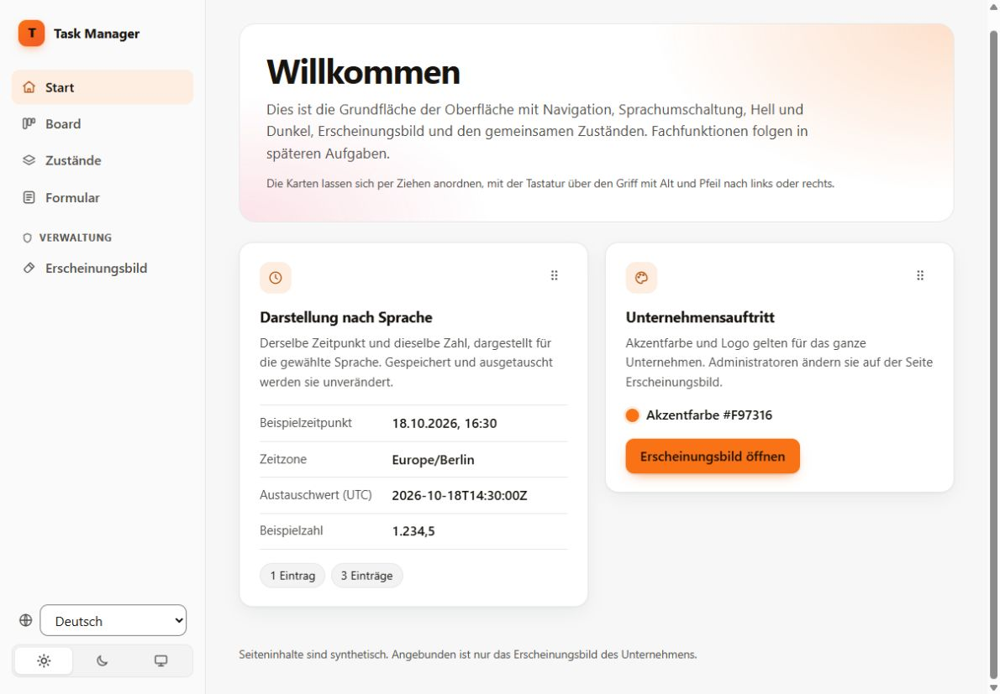
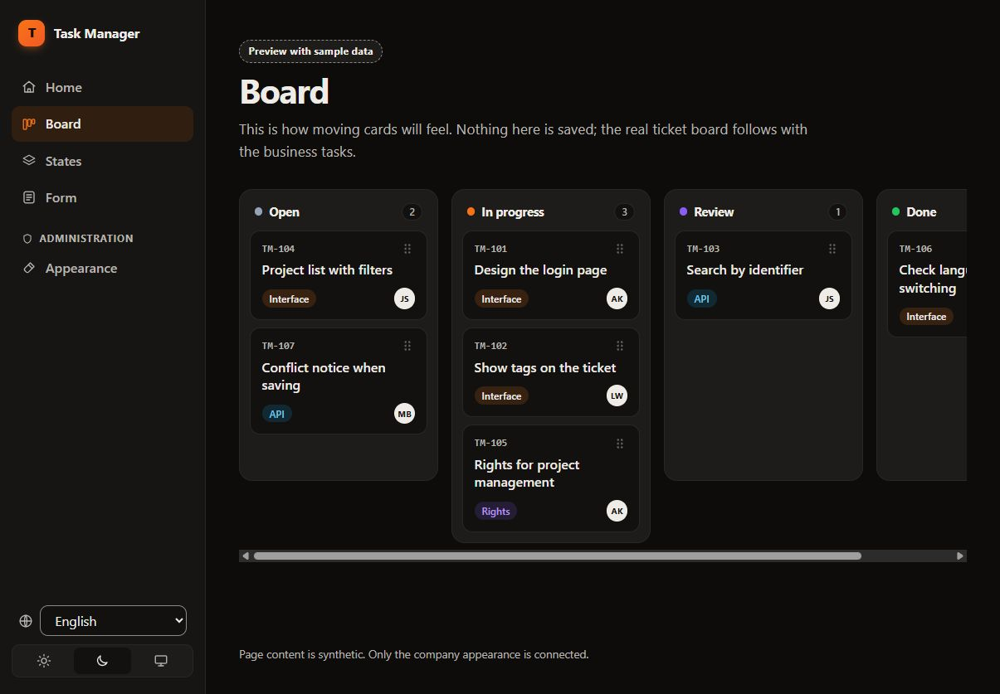
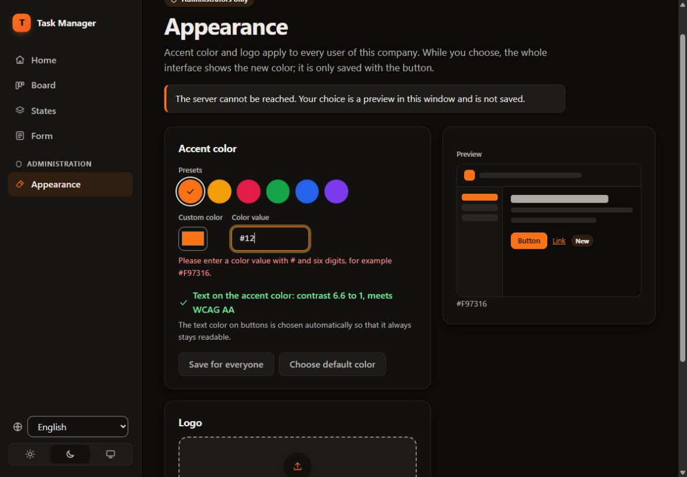
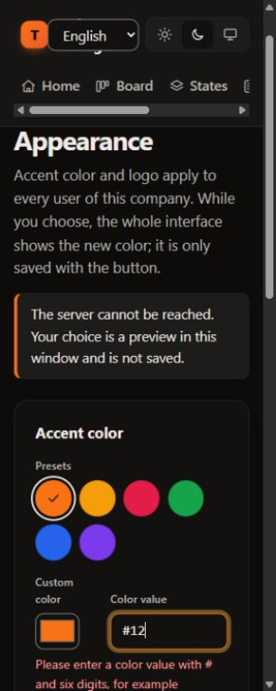

# Unabhängige Gegenprüfung TASK-036 / PR #85

19. Oktober 2026 · Codex-Sitzung `codex-20261019-appearance-review-01`.
Implementierung: `claude-20261019-design-01`. Technische Prüfung nach DEC-040,
eigener Worktree und Branch `review/task-036-pr85-codex`.

**Ergebnis: zwei mittlere Befunde und ein kleiner Darstellungsfehler.** Die vorhandenen
Tests bestehen, erfassen aber zwei reproduzierte Eingabeprobleme nicht. Die Grundfläche
ist übersichtlich, die Board-Vorschau klar als Beispieldaten bezeichnet und die geprüfte
Tastaturverschiebung erhält Fokus und Positionsansage. Keine fachliche Abnahme oder
allgemeine Sicherheits-/Barrierefreiheitsfreigabe.

## Prüfstand und vereinbarter Umfang

- [PR #85](https://github.com/1uedev/task-manager/pull/85), finaler Head
  `74eebeaaebc674925a6ba17bd558635423673e0d`, integriert mit `078e102`.
- Tatsächlich geprüft: main `b57a63f00210e216494daed1e86b66a821ada70d`.
  Ein eigener Git-Vergleich bestätigt identische Inhalte von Backend, Frontend,
  Verträgen und Workflows gegenüber dem finalen PR-Head. main vor Veröffentlichung
  erneut abgerufen; unverändert.
- Maßgeblich: TASK-036 in [TODO.md](../TODO.md), DEC-040/DEC-060, REQ-PROD-004,
  REQ-BRAND-001, REQ-UX-001 und REQ-I18N-001. Einstiegsdateien einschließlich
  AGENTS.md/CLAUDE.md, technische Basis, relevante Anforderungen, Entscheidungen,
  Architektur-/Modulverträge, OpenAPI, Implementierung und Tests gelesen.
- DEC-060 bestätigt vorläufig die Administratorkennzeichnung aus TASK-024.
  Die fehlende Ablösung durch ein eigenes Erscheinungsbildrecht ist deshalb hier kein
  neuer Befund. TASK-039 gehört Claude und wird weder übernommen noch vorweggenommen.
- Die frühere Migrationskollision ist im geprüften Stand durch **V0008** statt V0006
  adressiert; V0007 gehört TASK-038, V0006 bleibt frei. Der vollständige Backendlauf
  migriert erfolgreich. Kein zusätzlicher isolierter V0007→V0008-Upgradeversuch.

Dieser PR liefert ausschließlich Bericht und Nachweise unter `docs/`. Keine Änderung
an Produktcode, fremdem Branch, TODO.md, DONE.md, Zuständigkeiten oder Blockierungen.

## Befunde mit Vorschlag

### F1 · Mittel / P2 · Ungültiger sichtbarer Farbwert erlaubt das Speichern eines alten Entwurfs

**Fundstelle:** [AppearancePage.tsx:130–145](../frontend/src/pages/AppearancePage.tsx#L130).
Bei ungültigem Text ändert sich nur `hex`; `draft` behält die letzte gültige Farbe.
Die Speicherfreigabe in Zeile 144 berücksichtigt `hexValid` nicht und sendet `draft`.

**Reproduktion:** Administrator mit gespeicherter Farbe `#2563EB`; `#7C3AED` eingeben,
danach auf `#12` verkürzen. Das Feld ist `aria-invalid="true"` und zeigt die
Fehlermeldung, „Für alle speichern“ bleibt dennoch aktiv. Ein Klick sendet
`PUT /api/v1/appearance` mit `{"accentColor":"#7c3aed"}` und zeigt Erfolg.
Die zusätzliche Browsergegenprobe bestätigt genau diesen Request. Sie nutzt die
bestehende simulierte API und ist kein eigener Backend-End-to-End-Nachweis.

**Auswirkung:** Eine als fehlerhaft markierte Bearbeitung kann die globale Farbe
ändern; gespeicherter Wert und sichtbarer Eingabewert widersprechen sich. Keine
Umgehung der serverseitigen Farb- oder Rechteprüfung: Der gesendete Altwert ist gültig.

**Vorschlag:** Speichern bei ungültigem `hex` sperren und im Handler erneut prüfen;
die tatsächlich bestätigte gültige Eingabe verwenden. Regressionstest für
gültig → ungültig → Speichern ergänzen. Vorhandener Test „a typed color is checked
before it is shown“ prüft nur die Vorschau, nicht diesen Schreibpfad.

### F2 · Mittel / P2 · Eine PNG-Signatur genügt, um ein unbrauchbares Firmenlogo zu speichern

**Fundstellen:** [Logo.java:17–26](../backend/src/main/java/taskmanager/appearance/internal/Logo.java#L17),
[AppearanceService.java:69–82](../backend/src/main/java/taskmanager/appearance/internal/AppearanceService.java#L69),
[AppearanceApiTest.java:42–44](../backend/src/test/java/taskmanager/appearance/AppearanceApiTest.java#L42).

**Reproduktion über echte HTTP-Endpunkte:** Vollständig angemeldeter synthetischer
Administrator, korrektes CSRF und `If-Match: "1"`; Upload mit `Content-Type: image/png`
und ausschließlich `89 50 4e 47 0d 0a 1a 0a` (acht Byte). Ergebnis **200**, Version **2**,
ein Auditereignis; anschließendes Lesen liefert **200** und dieselben acht Byte.
Das enthält weder Bildkopf mit Abmessungen noch Bilddaten und ist kein darstellbares PNG.
Der zusätzliche Test erwartet Ablehnung mit 415 und scheitert mit genau einem
Assertion-Fehlschlag, ohne Ausführungsfehler.

**Auswirkung:** Beschädigte Dateien können das Firmenlogo für alle angemeldeten
Personen ersetzen. Die dokumentierte Signaturerkennung ist umgesetzt, belegt aber
keine gültige Bilddatei. Auch die als PNG/JPEG/WebP bezeichneten Positivfixtures im
Backendtest enthalten nur Dateianfänge. Es ist hier keine Skriptausführung oder
Rechteausweitung nachgewiesen; `nosniff`, Sandbox und die Administratorprüfung bleiben wirksam.

**Vorschlag:** Vor der Änderung eine vollständige, begrenzte Format-/Dekodierprüfung
für die drei vereinbarten Formate durchführen; eine dafür nötige Bibliothekswahl
abstimmen. Echte kleine Bilddateien als Positivfixtures und abgeschnittene Dateien als
Negativfälle verwenden. Bei Ablehnung müssen vorhandenes Logo, Version und Audit
unverändert bleiben. Das konkretisiert „ungültige Werte werden abgewiesen“ aus TASK-036.

### F3 · Niedrig / P3 · Markenname wird bei 320 Pixeln vom Sprachfeld überlagert

**Fundstelle:** [styles.css:362–368](../frontend/src/styles.css#L362) in Verbindung mit
`.brand`, `.brand-name` und `.sidebar-footer`.

**Reproduktion:** 320 CSS-Pixel, Englisch, Standardmarke ohne Logo; siehe Schritt 4.
Die Marke darf auf 23,41 Pixel schrumpfen, ihre Kinder laufen jedoch darüber hinaus.
Der sichtbare Markenname liegt bei x=66,39–133,16 und y=15,19–65,75; das Sprachfeld
bei x=55,41–161,00 und y=21,58–59,36. Beide Rechtecke überlappen sich. Die Seite selbst
scrollt dabei nicht horizontal (`clientWidth = scrollWidth = 305`, inklusive vertikaler
Scrollleiste bei 320 Pixel Ansichtsbreite).

**Vorschlag:** Bei schmaler Kopfleiste den Markennamen bewusst ausblenden oder
Anzeigeelemente in eine eigene Zeile umbrechen; zugänglichen Markennamen erhalten.
Zusätzlich zur bisherigen Seitenbreitenprüfung die Überlappung von Marke und
Anzeigeelementen mit und ohne Logo prüfen. Das vorhandene reine Overflow-Kriterium
erkennt diesen sichtbaren Reflowfehler nicht.

## Bedienprüfung und aktuelle Aufnahmen

Die vier Aufnahmen stammen aus diesem Prüflauf in der lokalen gebauten Oberfläche.
Jede gespeicherte Datei wurde anschließend visuell kontrolliert. Keine Autorenbilder
als eigene Beobachtung verwendet. Bei den Schritten 1–3 beträgt die Browseransicht
1205 × 837 CSS-Pixel, bei Schritt 4 320 × 800. Die Aufnahmen zeigen Ausschnitte des
jeweiligen Browserfensters, keine vollständige Konformitätsprüfung.

1. **Start, Deutsch, hell:** klare Trennung von Navigation, Einführung und Beispielkarten;
   Standardorange mit dunkler Schrift. Die Beispieldaten und der begrenzte Funktionsumfang
   sind erkennbar.

   

2. **Board, dunkel, anschließend Englisch:** „Anmeldeseite gestalten“ mit Alt+Pfeil rechts
   von Offen nach In Arbeit verschoben. Fokus bleibt auf derselben Karte; Live-Region
   meldet Spalte und Position 1 von 3. Danach Sprachwechsel; Beispielkennzeichnung bleibt
   verständlich. Das Board hat einen eigenen horizontalen Scrollbereich.

   

3. **Erscheinungsbild, Englisch, ungültige Eingabe:** `#12` wird mit Text und
   `aria-invalid` kenntlich gemacht; Fokus ist sichtbar. Der Offlinehinweis erklärt die
   reine Vorschau und verhindert globale Änderungen. Diese Aufnahme zeigt den
   Offlinefall, nicht den administrativen Schreibnachweis aus F1.

   

4. **Erscheinungsbild bei 320 Pixeln:** Inhalte und Farbvorlagen umbrechen, nur die
   Navigation scrollt innerhalb ihres eigenen Bereichs. F3 zeigt die verbleibende
   Überlagerung in der Kopfleiste. Die Ansichtsgrößenüberschreibung wurde zurückgesetzt.

   

## Tatsächlich ausgeführte Prüfungen

Windows, Temurin 25.0.4.1+1, Maven 3.9.16, eigene native PostgreSQL-18.6-Instanz auf
Loopback mit ausschließlich synthetischen Daten; Node 24.22.0 und npm 11.19.1.
Automatisierte Browserprüfungen mit installiertem Chrome in separaten Testkontexten;
manuelle Bedienbeobachtungen im In-App-Browser.

| Eigene Ausführung | Ergebnis und Aussagegrenze |
|---|---|
| Unverändertes Backend `verify`, externe Testdatenbankkonfiguration | **102 bestanden**, 0 Fehlschläge/Fehler/übersprungen; Build erfolgreich. Einschließlich Modul-/Migrationsprüfungen und echter HTTP-Tests für Rechte, Passwortwechselpflicht, CSRF, Version, Audit und Typ-/Größengrenzen. |
| `npm ci --ignore-scripts`, danach `npm run verify` | Installation, drei Typgenerierungen, Typprüfung, **71 Unit-Tests** und Build erfolgreich; keine Änderung der erzeugten Typen. |
| Unverändertes `npm run test:browser` | **45 bestanden**, 8 Suites, 0 Fehlschläge/übersprungen. Einschließlich Kontrastmessung in hell/dunkel, 320-Pixel-Overflow, Drag and Drop samt Tastatur sowie simulierten API-Abläufen. Backendantworten werden hier simuliert. |
| Zusätzliche Gegenprobe F1 | **1 gezielter Fehlschlag**, der den unerwünschten Schreibrequest belegt. |
| Zusätzliche echte HTTP-Gegenprobe F2 | **1 gezielter Fehlschlag**, 0 Ausführungsfehler; unerwünschte Speicherung und Rückgabe bestätigt. |
| Wiederherstellung und frischer Backendrücklauf | Beide temporär ergänzten Testdateien bytegenau wiederhergestellt. `clean test -Dtest=AppearanceApiTest`: **9 bestanden**, 0 Fehlschläge/Fehler/übersprungen; keine kompilierten Gegenproben bleiben zurück. |
| Repositoryprüfungen | Validator, Aufgabenübersicht, **25 Python-Tests** und Diffprüfung einschließlich neuer Dateien erfolgreich. |

Ein erster Start der zusätzlichen Backendgegenprobe verwendete irrtümlich
Umgebungsvariablen statt der vorgesehenen Java-Systemparameter und scheiterte am
fehlenden Docker-Daemon. Dieser Einrichtungsfehler wird nicht als Produktbefund
gewertet; obige F2-Aussage stammt aus dem danach korrekt konfigurierten HTTP-Lauf.
Der erste Pythonlauf ohne UTF-8-Modus meldete acht Fehlschläge bei Windows-
Zeichencodierungsvergleichen. Der dokumentierte erfolgreiche Wiederholungslauf
verwendet `PYTHONUTF8=1`; Repositoryquellen wurden dafür nicht geändert.

Beigefügte, von lokalen Pfaden bereinigte Nachweise:
[Messergebnisse](review-evidence/task-036/probe-results.txt),
[Browsergegenprobe F1](review-evidence/task-036/frontend-invalid-hex-probe.mjs.txt),
[HTTP-Gegenprobe F2](review-evidence/task-036/backend-truncated-logo-probe.java.txt).
Die Quellfragmente werden in die dort benannten bestehenden Tests mit deren Helfern
eingefügt; sie sind ausschließlich Nachweise, keine Änderung der aktiven Testsuite.

**Nicht ausgeführt:** Screenreaderprüfung, axe/Lighthouse, andere Browserfamilien,
produktive Installation, vollständiger integrierter Browserlauf mit echter Anmeldung,
gepinntes PostgreSQL-Dockerimage sowie der Bash-/SIGTERM-Lifecyclelauf. Kein neuer
isolierter Beweis für alle Nebenläufigkeits- und Sitzungsentzugsfälle. Screenshots
belegen Gestaltung und sichtbare Zustände, keine WCAG-Konformität. Der vereinbarte
verbindliche Zugänglichkeitsstandard bleibt offen.

## Übergabe an die Koordination

F1 und F2 vor der fachlichen Abnahme korrigieren und unabhängig nachprüfen; F3 bei der
mobilen Nachbesserung berücksichtigen. Änderungen und Zuständigkeit dafür über die
Koordination festhalten. TASK-036 bleibt ohne selbst gesetzte Abnahme in TODO.md;
TASK-039 und alle blockierten Fachaufgaben bleiben unberührt.
